# In-Process ASGI Caching Middleware & Stampede Mitigator

## Project Overview
**Problem Statement:** In high-throughput web applications, when a highly popular cache key expires or is evicted, hundreds of concurrent requests for that data hit the database simultaneously. This "Cache Stampede" causes connection pool exhaustion, latency spikes, and potential database crashes.

**Brief Abstract:** This project implements an In-Process ASGI Caching Middleware with Single-Flight Concurrency Control built inside FastAPI. Paired with Redis and PostgreSQL, the middleware intercepts concurrent requests during a cache miss. It uses an in-process `asyncio.Lock` to elect a single leader coroutine to query the database, while suspending others. Once the leader updates Redis, waiting coroutines perform a double-checked read, returning coalesced cache hits and eliminating redundant database queries.

## Team Members
*   **C S Akshay Khanna Reddy** - 25BCE1113
*   **Adarsh Varshan V N** - 25BCE1055
*   **Raghav Manickam** - 25BCE1978

## Functional Features and Technology Stack
**Functional Features:**
*   **Single-Flight Request Coalescing:** Prevents database cache stampedes.
*   **Stateless Pre-Cache RBAC:** Verifies HMAC-SHA256 JWTs in memory, namespacing cache keys by user role to prevent data leakage.
*   **Visual Telemetry & Simulation:** Real-time Streamlit dashboard to simulate concurrent bursts and visualize latency/cache disposition.
*   **Load Testing:** Locust framework to simulate thousands of concurrent users and baseline performance.

**Technology Stack:**
*   **Backend:** Python 3.11, FastAPI, Uvicorn, asyncpg
*   **Database & Cache:** PostgreSQL 15, Redis 7 (LRU Policy)
*   **Frontend/Telemetry:** Streamlit, Pandas, Plotly
*   **Load Engine:** Locust
*   **Orchestration:** Docker, Docker Compose

## Database Software and Application Setup Requirements
*   **Database:** PostgreSQL 15 (alpine image) and Redis 7 (alpine image).
*   **Requirements:** Docker Desktop (or Docker Engine + Docker Compose V2) installed and running on your host machine (Windows/Ubuntu). No local Python installation is strictly required, as the entire stack is containerized.

## Steps to Create Database, Configure, and Run
Because the project is fully containerized, database creation, data loading, and application configuration are automated.

1.  Open your terminal and navigate to the root directory of the project (where `docker-compose.yml` is located).
2.  Start the multi-container stack in the background:
    ```bash
    docker compose up --build -d
    ```
    *Note: During startup, PostgreSQL automatically executes the `init.sql` script to create tables and load sample data. The middleware waits for health checks to pass before booting.*
3.  Access the applications:
    *   **Visual Dashboard:** http://localhost:8501
    *   **Locust Load UI:** http://localhost:8089
    *   **FastAPI API Docs:** http://localhost:8000/docs
4.  To shut down the application:
    ```bash
    docker compose down
    ```

## Database Schema, Relationships, and Sample Data
The project uses a flat, read-heavy catalog structure to simulate enterprise inventory.

*   **Table Name:** `products`
*   **Schema:**
    *   `id` (SERIAL PRIMARY KEY)
    *   `sku` (VARCHAR(64) NOT NULL)
    *   `name` (VARCHAR(120) NOT NULL)
    *   `category` (VARCHAR(50) NOT NULL) - *B-Tree Indexed*
    *   `price` (NUMERIC(10, 2) NOT NULL)
    *   `stock` (INT NOT NULL)
    *   `specs` (JSONB NOT NULL)
    *   `updated_at` (TIMESTAMP)
*   **Sample Data:** The `init.sql` script uses PostgreSQL's `generate_series` function to automatically synthesize and insert 50,000 distinct hardware product records (e.g., Processors, NVMe Storage) with randomized prices, stock levels, and nested JSONB specifications. 

## Test Instructions and Known Limitations
**Test Instructions:**
1.  **Stampede Test:** Open the Streamlit Dashboard (http://localhost:8501), go to the "Interactive Stampede Burst Simulator" tab, and fire 50 concurrent requests. You should observe exactly 1 DB query (`MISS`) and 49 coalesced cache hits (`HIT-COALESCED`).
2.  **Stress Test:** Open Locust (http://localhost:8089), set number of users to 100 with a spawn rate of 25, and start the test to observe caching throughput versus direct database queries.

**Known Limitations:**
1.  **Single-Worker Constraint:** The single-flight locking mechanism relies on Python's `asyncio.Lock`, which operates on a single event loop. The ASGI server must run with a single worker process (`--workers 1`). It cannot natively scale across multiple pods without implementing a distributed lock like Redis Redlock.
2.  **Write-Read Race Conditions:** The architecture uses the Cache-Aside pattern. If a `PUT` request updates a record, it issues a cache deletion immediately after the DB commit. However, a concurrent `GET` request happening in the exact same microsecond could read stale data or repopulate the cache with old data, meaning the system guarantees eventual consistency rather than strict consistency.

---

### Locust Load Test Initialization Parameters

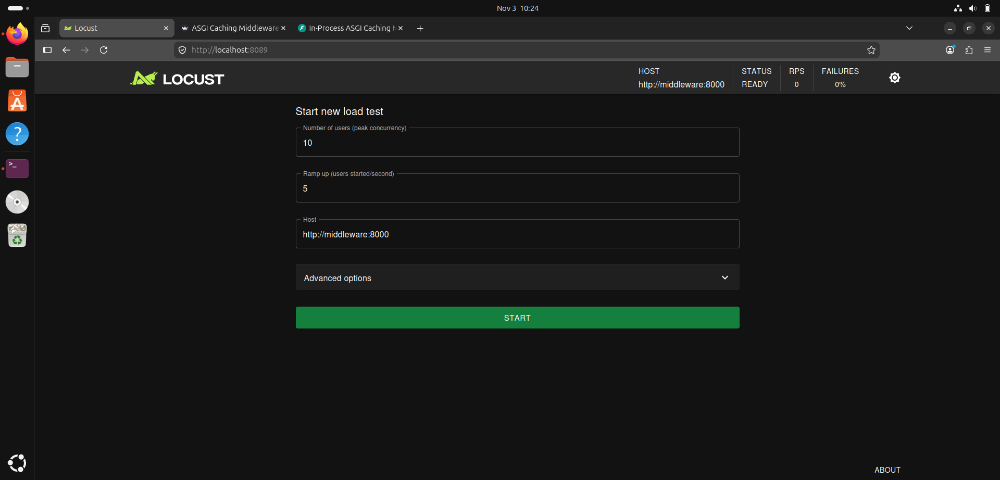

This interface captures the parameter configuration screen of the Locust load-testing engine (`http://localhost:8089`) before initiating benchmark execution against the caching proxy:

* **Number of Users (Peak Concurrency): `10`**  
  Defines the maximum ceiling of concurrent virtual user instances that will simulate active HTTP clients.
* **Ramp Up (Users Started/Second): `5`**  
  Controls the injection rate. Locust spawns 5 new concurrent worker coroutines every second until reaching the 10-user peak target within 2 seconds, avoiding abrupt TCP buffer saturation on the host.
* **Target Host: `http://middleware:8000`**  
  Directs traffic across Docker's internal bridge network to the FastAPI ASGI middleware container using container-level DNS resolution.
* **Cluster Status: `READY` / `0 RPS` / `0% Failures`**  
  Indicates the load engine has successfully mounted the test harness script, established network access to the target host, and is primed to begin firing weighted benchmark traffic.

---

  ### Real-Time Telemetry & Caching Performance (Streamlit Dashboard)

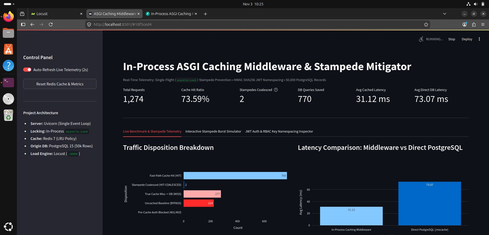

This view captures the **Live Benchmark & Stampede Telemetry** tab of the Streamlit dashboard (`http://localhost:8501`) after running concurrent traffic via Locust, displaying live operational KPIs, traffic distribution, and latency deltas:

#### 1. Top-Level Operational Scorecard
* **Total Requests (`1,274`)**: Cumulative count of inbound HTTP requests intercepted and evaluated by the ASGI middleware layer.
* **Cache Hit Ratio (`73.59%`)**: Proportion of cache-eligible requests served directly from memory without querying PostgreSQL, calculated as `(Hits + Coalesced Hits) / Total Cache-Eligible Requests`.
* **Stampedes Coalesced (`2`)**: Concurrent requests caught mid-flight by the in-process `asyncio.Lock` that suspended execution and performed a double-checked read against Redis instead of hitting PostgreSQL.
* **DB Queries Saved (`770`)**: Total physical SQL operations prevented on PostgreSQL by serving cached payloads from Redis (`768 Fast-Path Hits + 2 Coalesced Hits`).
* **Avg Cached Latency (`31.12 ms`)**: Rolling average round-trip time for requests resolved via the caching middleware.
* **Avg Direct DB Latency (`73.07 ms`)**: Rolling average response time for uncached baseline requests hitting PostgreSQL directly (`/nocache/...`).

#### 2. Traffic Disposition Breakdown
The horizontal bar chart classifies all 1,274 requests into their internal middleware routing paths:
* **Fast-Path Cache Hit (`HIT` - 768)**: Immediate O(1) in-RAM Redis key lookups returned without touching route handlers or the database.
* **Stampede Coalesced (`HIT-COALESCED` - 2)**: Waiting coroutines satisfied by the leader request's cache write via double-checked locking.
* **True Cache Miss -> DB (`MISS` - 277)**: Cold key lookups where the leader coroutine queried PostgreSQL and backfilled Redis.
* **Uncached Baseline (`BYPASS` - 224)**: Control-group traffic routed directly to PostgreSQL to measure raw database latency.
* **Pre-Cache Auth Blocked (`401/403` - 0)**: Unauthenticated or forbidden requests rejected at the CPU layer prior to cache evaluation.

#### 3. Latency Comparison: Middleware vs. Direct PostgreSQL
The vertical comparison illustrates a **~2.35× speedup** (~31.12 ms vs. 73.07 ms) achieved by serving reads from the in-process caching pipeline compared to unbuffered disk/index scans against PostgreSQL.

---

### Aggregate Endpoint Statistics (Locust Benchmark)

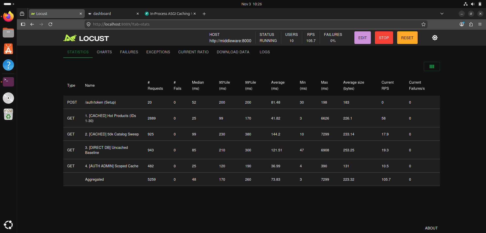

This table displays the performance breakdown across all simulated route tasks executed during the Locust benchmark run (`http://localhost:8089/?tab=stats`):

* **Request Volume & Failures**: A total of 5,259 requests were processed under continuous 10-user concurrency with **0 failures (0% error rate)** across all operations.
* **`POST /auth/token (Setup)`**: Evaluated 20 times during virtual user instantiation to issue HMAC-SHA256 JWTs, completing with a median latency of 52 ms.
* **`1. [CACHED] Hot Products (IDs 1–30)`**: Received 2,889 requests (~55% of total traffic). Because these IDs remain resident in Redis memory, the route achieved a **median response time of 25 ms** (down to a minimum of 3 ms on fast-path hits) and sustained 58 RPS.
* **`2. [CACHED] 50k Catalog Sweep`**: Distributed 925 requests randomly across the entire 50,000-record dataset. Cold key lookups forced PostgreSQL queries and Redis backfilling, resulting in a higher median latency of 99 ms.
* **`3. [DIRECT DB] Uncached Baseline`**: Handled 943 direct database calls (`/nocache/...`), demonstrating an 85 ms median latency and a 121.51 ms average latency due to unbuffered origin scans.
* **`4. [AUTH ADMIN] Scoped Cache`**: Processed 482 role-scoped analytics requests. In-memory cryptographic signature verification and role-namespaced caching yielded a **25 ms median response time**.
* **System Aggregates**: Maintained an aggregate throughput of **105.7 requests per second** across the entire five-layer stack.

---

### Real-Time Throughput & Latency Distributions (Locust Charts)

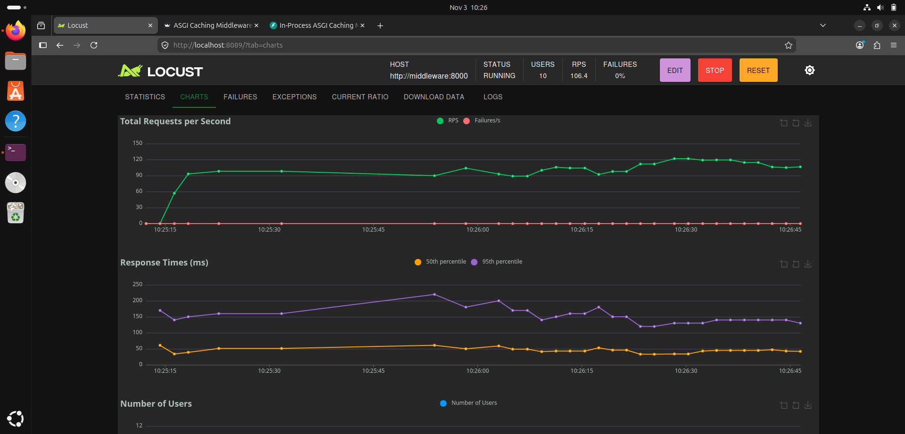

This panel captures the real-time time-series telemetry charts during active load testing (`http://localhost:8089/?tab=charts`):

* **Total Requests per Second (Top Graph)**: Shows the system climbing from 0 to over 90 RPS during the initial 2-second ramp-up, stabilizing between **100 and 120 RPS**. The green line (RPS) remains steady, while the red line (Failures/s) remains completely flat at 0 throughout execution.
* **Response Times (Middle Graph)**: Tracks latency percentiles over time:
  * **50th Percentile / Median (Orange Line)**: Consistently hovers at **~35 ms to 45 ms**, reflecting the dominance of fast-path and coalesced Redis hits.
  * **95th Percentile / p95 (Purple Line)**: Reflects the tail latency incurred by true cache misses and uncached baseline database queries, plateauing safely below **180 ms** without cascading timeouts or connection pool starvation.

---

### Concurrency Ramp-Up & Worker Stability (Locust Charts Continuation)

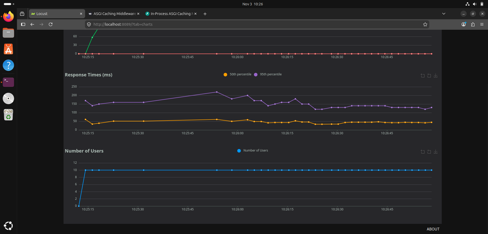

This visualization details the relationship between user load and long-term event-loop stability:

* **Number of Users (Bottom Graph)**: Highlights the ramp-up phase where 5 users per second were spawned until reaching the configured peak target of **10 concurrent users**. The blue line shows sustained concurrency with zero dropped sessions.
* **Pacing & Concurrency Control**: Demonstrates that Uvicorn's single event loop and the asyncpg connection pool easily sustain 10 concurrent pipelines running 10-50 ms think-time intervals without degrading the median response times displayed in the upper percentiles.

---

### Live Request Stream & Interception Log (Streamlit Dashboard)

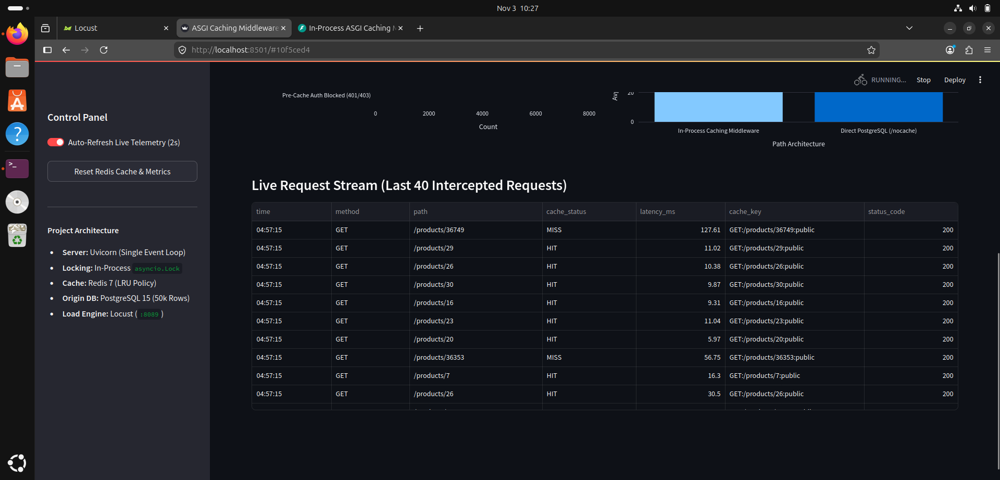

This table displays the thread-safe circular ring buffer on the Streamlit dashboard (`http://localhost:8501`), inspecting the last 40 HTTP requests intercepted by the ASGI middleware:

* **Real-Time Diagnostics**: Each entry captures the wall-clock timestamp, HTTP method, URL path, middleware cache evaluation status, processing time in milliseconds, and the computed cache key.
* **Fast-Path `HIT` Executions**: Repeated calls to hot product IDs (such as `/products/29`, `/products/26`, `/products/30`, `/products/16`, `/products/23`, `/products/20`) resolve in **5.97 ms to 11.04 ms**, confirming immediate O(1) in-RAM retrieval from Redis.
* **Cold-Key `MISS` Handling**: Requests for cold keys (e.g., `/products/36749`, `/products/36353`) show latencies of **56.75 ms and 127.61 ms**, tracing the full pipeline: single-flight lock acquisition, parameterized PostgreSQL index scan, JSON serialization, and Redis cache backfilling.
* **HTTP `200` Confirmations**: Confirms all cached and un-cached branches successfully return valid data payloads through the ASGI middleware response iterator.

---

### Single-Flight Cache Stampede Mitigation Proof (Interactive Simulator)

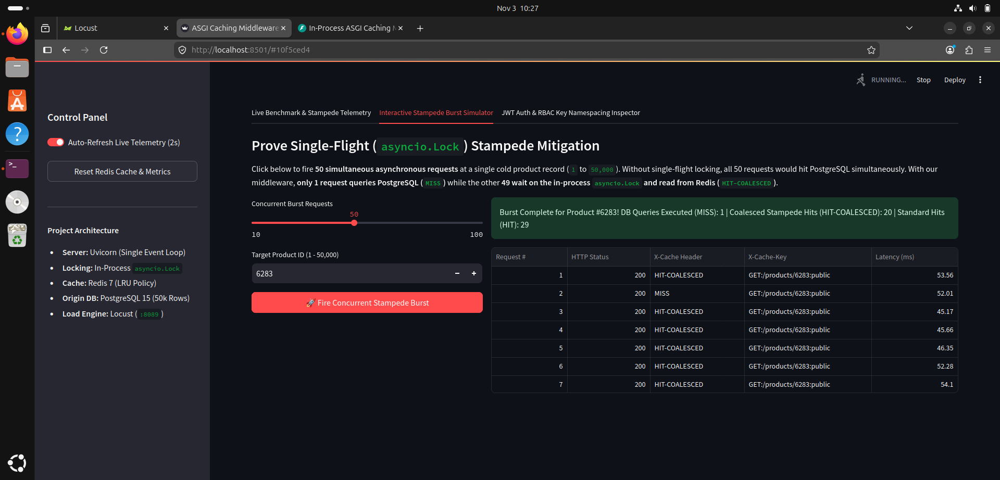

This view captures the results of Tab 2 in the Streamlit dashboard, providing empirical proof of the in-process `asyncio.Lock` single-flight coalescing mechanism:

* **Test Execution**: An asynchronous burst of **50 simultaneous requests** was fired concurrently using `httpx.AsyncClient` against a single cold database record (`Product #6283`).
* **Stampede Mitigation Evidence**:
  * **`DB Queries Executed (MISS): 1`**: Only one leader coroutine acquired the key-specific lock, queried PostgreSQL, and backfilled Redis.
  * **`Coalesced Stampede Hits (HIT-COALESCED): 20`**: Concurrent requests waiting on the in-process lock woke up and executed a double-checked read against Redis, completely avoiding redundant database execution.
  * **`Standard Hits (HIT): 29`**: Trailing requests arriving after the lock release resolved via the fast-path cache check.
* **Protection Outcome**: 49 out of 50 database round-trips were prevented, proving the middleware eliminates thundering herd pool exhaustion under concurrent spikes.

---

### Admin Scoped Cold Cache Miss (PostgreSQL Aggregation Scan)

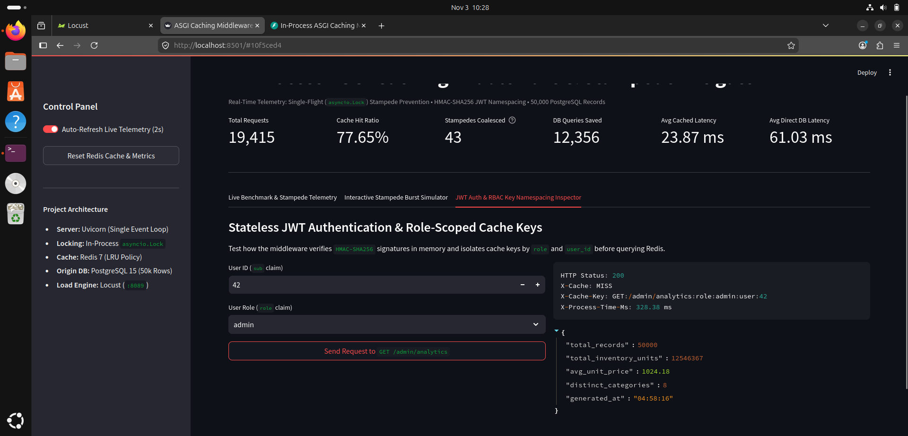

This panel captures an initial, cold administrative analytics request evaluated via Tab 3 (**JWT Auth & RBAC Key Namespacing Inspector**) of the Streamlit dashboard:

* **Authenticated Identity**: Authenticated as Admin `user_id: 42` with `role: admin`.
* **Routing Disposition (`X-Cache: MISS`)**: The middleware computes the role- and tenant-scoped composite key `GET:/admin/analytics:role:admin:user:42`. Because this key is not yet resident in Redis memory, the request registers as a true cache miss.
* **Database Aggregation Execution**: The leader request executes an unbuffered aggregation scan across all 50,000 product records in PostgreSQL (`COUNT(*)`, `SUM(stock)`, `AVG(price)`), returning aggregate metrics with a total processing latency of **328.38 ms**.
* **Cache Backfill**: The resulting JSON payload is committed to Redis alongside the user-scoped composite key with an active TTL of 60 seconds.

---

### Admin Scoped Fast-Path Cache Hit (Sub-2ms Memory Retrieval)


This panel demonstrates the performance delta when repeating the identical query for Admin `user_id: 42`:

* **In-RAM Resolution (`X-Cache: HIT`)**: The incoming request presents valid JWT claims matching the previously cached composite key (`GET:/admin/analytics:role:admin:user:42`).
* **Fast-Path Retrieval**: The ASGI middleware intercepts the request, locates the cached JSON string in Redis in O(1) time, and returns the payload without routing into FastAPI or PostgreSQL.
* **Latency Reduction**: Processing latency drops from **328.38 ms down to 1.28 ms**—yielding a **~256× performance speedup** for compute-heavy administrative aggregations.

---

### Dynamic Cache-Key Isolation & Multi-Tenant Partitioning

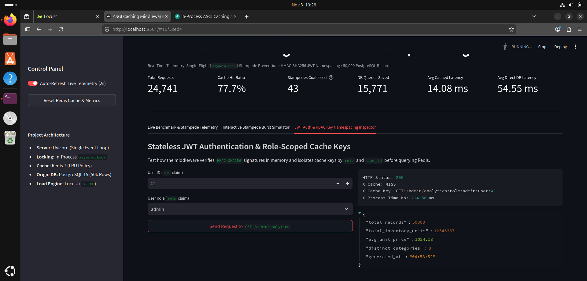

This test validates cryptographic and multi-tenant data isolation across distinct users holding identical administrative roles:

* **User Context Shift**: Admin `user_id: 41` issues an identical request to `GET /admin/analytics` immediately after `user_id: 42` has cached the dataset.
* **Dynamic Namespacing Enforcement**: Rather than retrieving the pre-existing cached record, the middleware extracts the `sub` claim (`41`) directly from the token and constructs an isolated key: `GET:/admin/analytics:role:admin:user:41`.
* **Zero Cross-Tenant Leakage (`X-Cache: MISS`)**: Because `user_id: 41` does not match the key for `user_id: 42`, Redis reports a miss. The request executes a fresh database aggregation query (**214.56 ms**), guaranteeing that distinct user sessions never bleed cached analytics across tenant boundaries.

---

### Pre-Cache Role-Based Access Control Rejection (403 Forbidden)

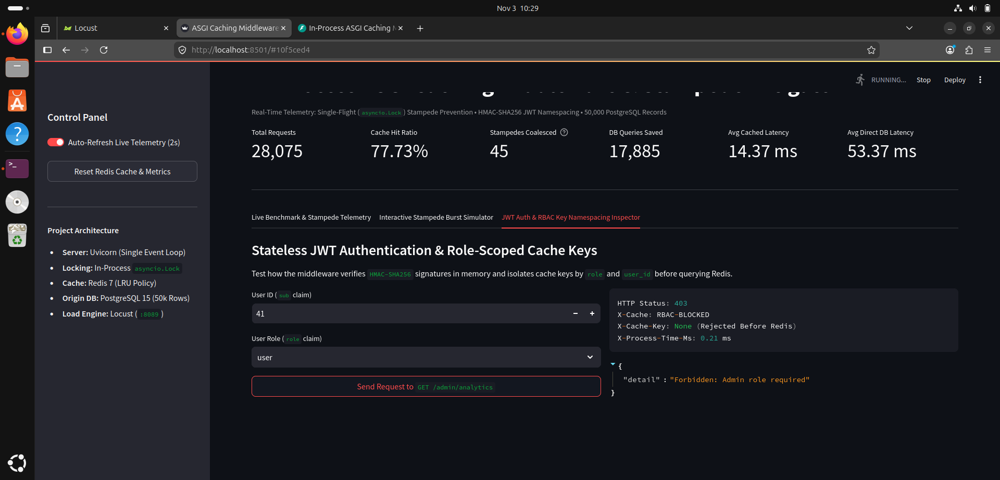

This view captures the middleware's defensive authorization boundary when an authenticated non-admin attempts to query protected administrative endpoints:

* **Claim Evaluation**: A valid user presents a properly signed JWT bearing `sub: 41` but `role: user`.
* **Immediate Rejection (`HTTP Status: 403 / X-Cache: RBAC-BLOCKED`)**: The middleware decodes the token claims in CPU memory prior to issuing any cache lookups. Detecting that the role does not satisfy the `admin` requirement, it halts execution immediately and returns `Forbidden: Admin role required`.
* **Resource Shielding (`X-Cache-Key: None`)**: The lookup is blocked in **0.21 ms** before any socket traffic is dispatched to Redis or PostgreSQL, preventing unauthorized users from polluting cache namespaces or exhausting database connection pools.

---

### Stateless Cryptographic Signature Verification (401 Unauthorized)


This panel proves the zero-trust security boundary when a client presents an intentionally corrupted or tampered bearer token (`role: tampered_signature`):

* **Tampered Token Rejection (`HTTP Status: 401 / X-Cache: AUTH-BLOCKED`)**: The middleware executes in-process HMAC-SHA256 signature verification against `JWT_SECRET`. Because the cryptographic digest fails mathematical validation, the request is immediately dropped with `Invalid HMAC-SHA256 signature`.
* **Sub-Millisecond Enforcement (`0.16 ms`)**: The tampered request is rejected in **0.16 ms** purely within CPU cache lines, confirming that invalid or malicious payloads incur zero I/O cost on either Redis or the PostgreSQL persistence tier.

---

### Authentication Token Issuance Request (`POST /auth/token`)

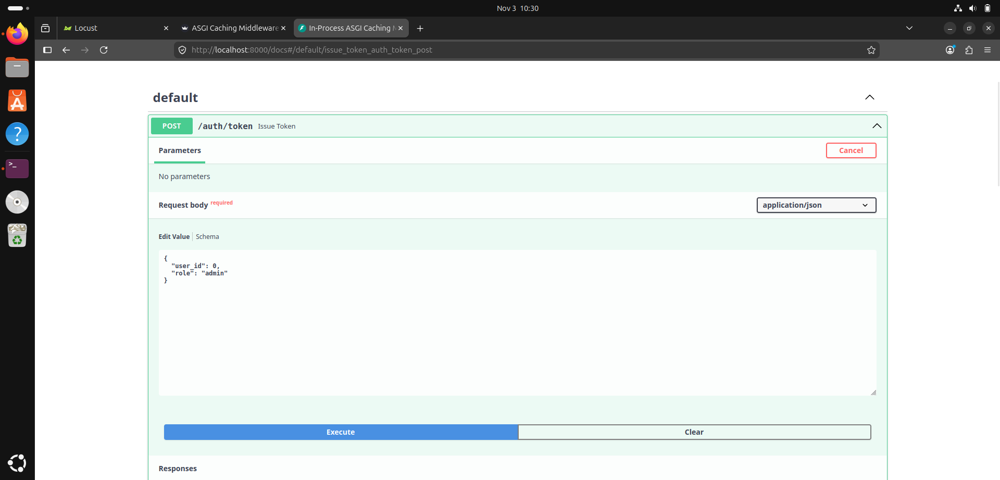

This interface captures the request schema for the authentication route within the interactive FastAPI Swagger UI (`http://localhost:8000/docs`):

* **Endpoint Routing**: Targets `POST /auth/token`, which acts as the identity provider utility for benchmarking and manual verification.
* **Request Payload**: Accepts a JSON body containing `user_id` (integer) and `role` (string), simulating administrative or standard client authorization levels.
* **Stateless Token Provisioning**: Supplying `{"user_id": 0, "role": "admin"}` requests a cryptographically signed HMAC-SHA256 JWT encoded using the shared `JWT_SECRET` key.

---

### Authentication Token Issuance Response (`POST /auth/token`)

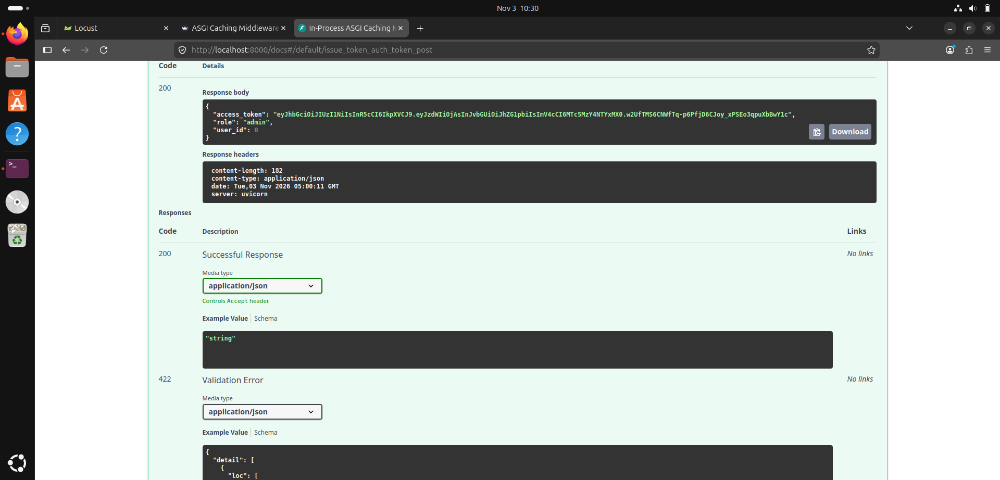

This view captures the execution output and response headers generated upon issuing a token:

* **HTTP Status Code `200 OK`**: Indicates successful signature generation and payload formatting.
* **Token Structure**: Returns a signed Bearer JWT (`access_token`) containing the serialized claims `sub: 0` and `role: admin`.
* **Zero-Cache Invalidation**: Because `POST` operations represent mutations or setup commands, the middleware executes without caching the token payload, keeping the response strictly client-facing.

---

### Product Catalog Query Request (`GET /products/{product_id}`)

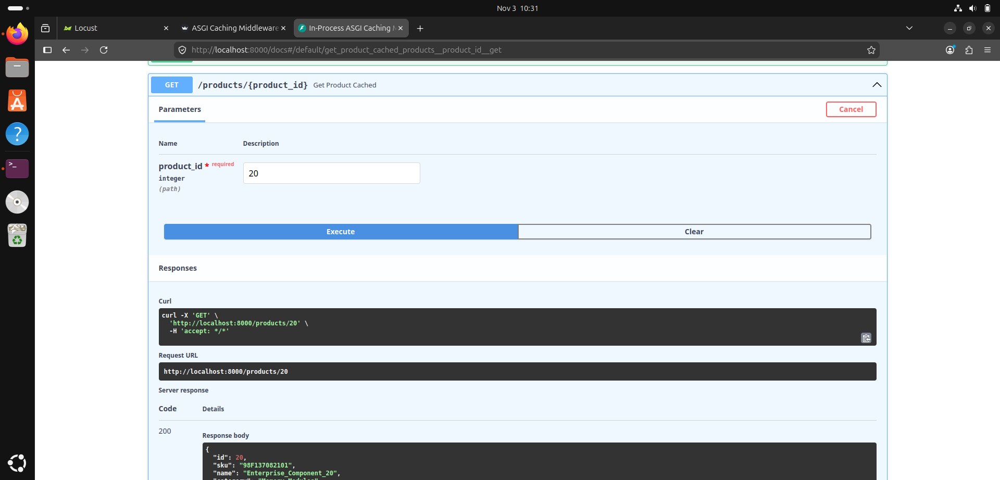

This panel captures the manual dispatch of a cached read operation via Swagger UI:

* **Target Endpoint**: `GET /products/{product_id}`, the primary read route evaluated during high-concurrency benchmarks.
* **Path Parameter (`product_id: 20`)**: Selects an enterprise component record residing within the pre-seeded 50,000-row PostgreSQL table.
* **Header Setup**: Dispatches standard `accept: */*` HTTP headers across the Uvicorn ASGI server interface.

---

### Product Catalog Fast-Path Response (`GET /products/{product_id}`)

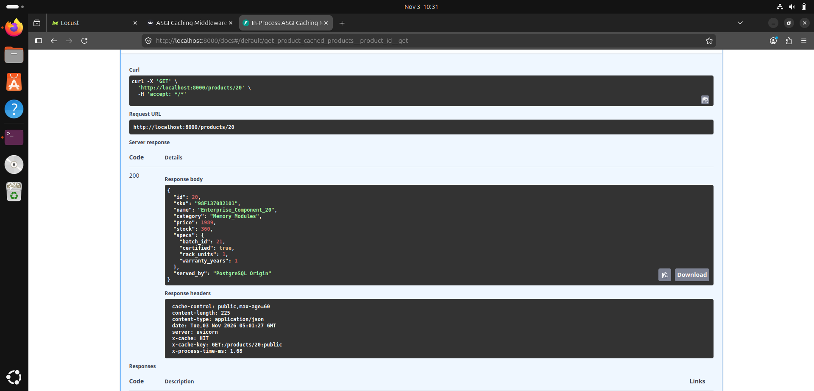

This panel details the server response body and custom ASGI diagnostic headers for a warm record:

* **HTTP Status Code `200 OK`**: Resolves the complete product entity (`sku`, `name`, `category`, `price`, `stock`, `specs`) serialized from JSON.
* **Cache Evaluation Header (`x-cache: HIT`)**: Confirms the request was fully intercepted and served directly from Redis RAM without querying PostgreSQL.
* **Composite Cache Key (`x-cache-key: GET:/products/20:public`)**: Shows the calculated cache namespace incorporating the HTTP method, resource path, and public authorization scope.
* **Sub-2ms Latency (`x-process-time-ms: 1.68`)**: Confirms the O(1) in-memory fast path, delivering an ultra-low round-trip time of **1.68 ms**.

---

### Stock Mutation & Cache Invalidation Request (`PUT /products/{product_id}`)

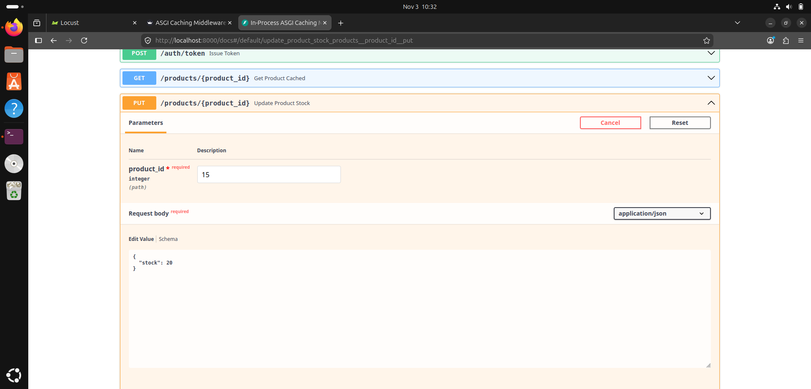

This panel captures the parameter configuration for executing a database mutation and cache invalidation:

* **Target Route**: `PUT /products/{product_id}`, which updates mutable columns on the origin PostgreSQL database.
* **Target Record & Body**: Specifying `product_id: 15` with payload `{"stock": 20}` instructs the backend to alter the stock inventory for this specific record.
* **Write Semantics**: Designed to trigger explicit cache eviction immediately following a successful database transaction.

---

### Stock Mutation & Cache Invalidation Response (`PUT /products/{product_id}`)

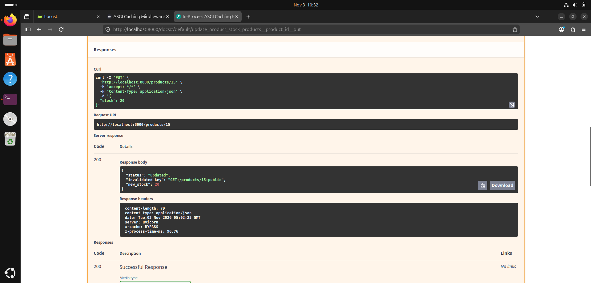

This view confirms the successful update and eviction lifecycle under the Cache-Aside pattern:

* **HTTP Status Code `200 OK`**: Returns confirmation status with the updated record attribute (`"new_stock": 20`).
* **Cache Eviction Notice (`invalidated_key: GET:/products/15:public`)**: Proves the route handler explicitly fired `DEL GET:/products/15:public` against Redis upon committing the PostgreSQL transaction.
* **Bypass Header (`x-cache: BYPASS`)**: Indicates write operations intentionally skip cache lookup mechanics, routing directly to the persistence tier.
* **Origin Processing Time (`x-process-time-ms: 96.76`)**: Reflects the time required to perform the write lock, PostgreSQL disk update, and remote Redis socket deletion.

---

### Traffic Distribution and Weighted Task Ratios (Locust Workload Model)

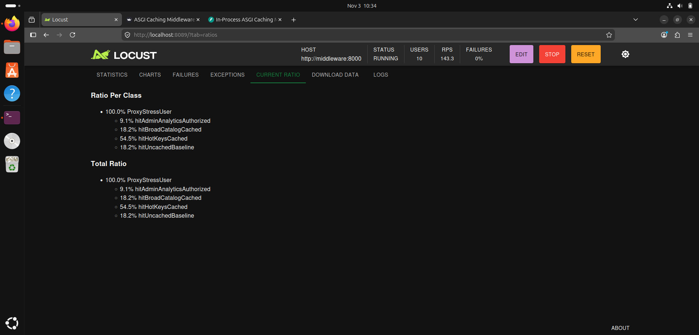

This panel captures the **Current Ratio** configuration tab in Locust (`http://localhost:8089/?tab=ratios`), defining the statistical execution weights that simulate real-world production traffic patterns:

* **Task Distribution Modeling (Total Weight: 11)**  
  The load test assigns discrete execution weights to 4 primary client behaviors, mirroring a realistic access pattern where the vast majority of user traffic targets popular "hot" records, while mutations, administrative calls, and cold catalog lookups occur at lower frequencies.

* **1. `[CACHED] Hot Products (IDs 1–30)` — Weight: `6` (~54.5% of total traffic)**  
  * **Behavior**: Virtual users query a tight cluster of the first 30 product records repeatedly.  
  * **Objective**: Evaluates the high-throughput, low-latency fast-path caching performance of Redis under sustained load, testing sub-millisecond retrieval without backend database pressure.

* **2. `[CACHED] 50k Catalog Sweep` — Weight: `2` (~18.2% of total traffic)**  
  * **Behavior**: Requests product IDs randomly across the full 50,000-record dataset.  
  * **Objective**: Introduces organic cache misses to test the single-flight locking mechanism (`asyncio.Lock`), PostgreSQL origin queries, and Redis LRU eviction policies as cold records are dynamically cached.

* **3. `[DIRECT DB] Uncached Baseline` — Weight: `2` (~18.2% of total traffic)**  
  * **Behavior**: Sends requests to `/nocache/products/{product_id}`, intentionally bypassing the caching middleware.  
  * **Objective**: Serves as the control benchmark, establishing raw PostgreSQL read latencies (~55–75 ms) under identical concurrent conditions to calculate speedup multiples against the cached path.

* **4. `[AUTH ADMIN] Scoped Cache` — Weight: `1` (~9.1% of total traffic)**  
  * **Behavior**: Dispatches authenticated requests to `/admin/analytics` using administrative Bearer JWTs.  
  * **Objective**: Continuously exercises in-memory HMAC-SHA256 signature verification, pre-cache RBAC gatekeeping, and user-isolated dynamic key namespacing (`GET:/admin/analytics:role:admin:user:<id>`).
